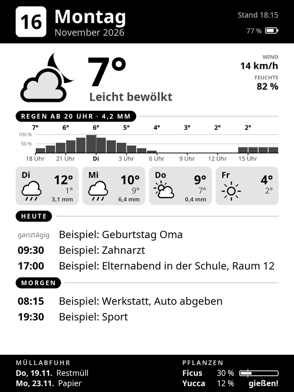

# kindle-display

A small server that draws a 600×800 greyscale status page for an old Kindle from
[Home Assistant](https://www.home-assistant.io/) data. The Kindle fetches the picture with
[kindle-dash](https://github.com/pascalw/kindle-dash).



The picture is drawn directly with Python and Pillow. There is no headless browser and no
dashboard screenshot, so the container is small and a render takes well under a second.

The page is in German, and so are the identifiers and comments in the code.

## What it shows

- Date, time of the last update and the Kindle's battery level
- Current weather with wind and humidity, taken from a Home Assistant weather entity
- Chance of rain for the next 24 hours as a bar chart, with the temperature every three hours.
  If no rain is expected, room temperatures are shown in its place.
- Forecast for the next four days
- Appointments for today and tomorrow. Today always comes first; tomorrow gets the lines that are left.
- The next two waste collection days
- Soil moisture of up to two plants, each with a watering threshold
- At night the sun is replaced by the moon in its current phase

## How it works

| File | Purpose |
| --- | --- |
| `server.py` | HTTP server on port 5000. Every request draws a fresh PNG. |
| `daten.py` | Reads everything from the Home Assistant REST API (read-only). |
| `bild2.py` | The layout. |
| `bild.py` | Drawing helpers, weather symbols and an older, plainer layout. |
| `einstellungen.beispiel.py` | Template for your entity names. |
| `kalenderfilter.py` | Optional: repairs public iCloud calendars so Home Assistant accepts them. |
| `kindle/` | The two files to put on the Kindle for kindle-dash. |
| `INSTALL.md` | Step-by-step guide for a coding agent. |

If Home Assistant cannot be reached, the server returns the last good picture for up to six hours.

## Setup

### Option A: let your coding agent do it

→ Copy this to your coding agent (Claude Code, Codex, Hermes Agent, pi or whatever you prefer):

```
Read https://raw.githubusercontent.com/Josi-create/kindle-display/main/INSTALL.md and follow it.
```

[INSTALL.md](INSTALL.md) tells the agent how to set up the server and Home Assistant and how to
guide you through jailbreaking the Kindle and installing kindle-dash.

### Option B: by hand

1. Create a Home Assistant user without admin rights and a long-lived access token for it.
2. Copy the templates and fill them in:

   ```sh
   cp ha.env.beispiel ha.env && chmod 600 ha.env
   cp einstellungen.beispiel.py einstellungen.py
   ```

   `ha.env` holds the Home Assistant address and the token. `einstellungen.py` lists the weather
   entity, calendars, waste calendar, plant sensor and room sensors.
3. Start the server:

   ```sh
   docker compose up -d --build kindle-anzeige
   ```

4. Open `http://<server>:5000/` in a browser to check the picture.

To try the layout without Home Assistant, run `python bild2.py beispiel.png`. It needs Pillow and
the Noto Sans fonts and draws the example above.

#### Kindle

Install [kindle-dash](https://github.com/pascalw/kindle-dash) as described there, then replace
`local/fetch-dashboard.sh` and `local/env.sh` on the Kindle with the files from `kindle/`. Enter
your server's address in `fetch-dashboard.sh`. Tested on a Kindle 4.

### Battery level (optional)

`fetch-dashboard.sh` appends `?batteryLevel=…&isCharging=…` to the request. The server passes both
values to a Home Assistant webhook, so the battery level can be shown on the page and used in
automations. Put the webhook ID into `ha.env` and add something like this to Home Assistant:

```yaml
input_number:
  kindle_akku:
    name: Kindle Akku
    min: 0
    max: 100
    step: 1
    unit_of_measurement: "%"

input_boolean:
  kindle_ladevorgang:
    name: Kindle lädt

automation:
  - alias: Kindle Akkustand übernehmen
    trigger:
      - platform: webhook
        webhook_id: !secret kindle_webhook
        allowed_methods: [POST]
        local_only: true
    action:
      - service: input_number.set_value
        target:
          entity_id: input_number.kindle_akku
        data:
          value: "{{ trigger.json.batteryLevel }}"
      - service: "input_boolean.turn_{{ 'on' if trigger.json.isCharging else 'off' }}"
        target:
          entity_id: input_boolean.kindle_ladevorgang
```

### iCloud calendars (optional)

Public iCloud calendar files can contain raw line breaks and duplicate properties, which Home
Assistant's Remote Calendar integration rejects. `kalenderfilter.py` fetches the calendar, repairs
it and serves it on `127.0.0.1:5001`.

```sh
cp .env.beispiel .env && chmod 600 .env    # enter the public iCloud link
docker compose --profile icloud up -d kalender-filter
```

Then add `http://127.0.0.1:5001/privat.ics` as a Remote Calendar in Home Assistant.

## Data sources and privacy

All data comes from your own Home Assistant, with one exception: the chance of rain. The met.no
forecast used by Home Assistant does not include it outside the Nordic countries, so the server
asks [Open-Meteo](https://open-meteo.com/) at most every 30 minutes. For that it sends your home
location rounded to two decimal places (about 1 km). Set `OPEN_METEO = False` in `einstellungen.py`
to switch this off; the room temperatures are then shown instead of the chart.

## Credits

- [pascalw/kindle-dash](https://github.com/pascalw/kindle-dash) runs on the Kindle and fetches the picture.
- [sibbl/hass-lovelace-kindle-screensaver](https://github.com/sibbl/hass-lovelace-kindle-screensaver)
  was the starting point; the battery parameters follow its convention.
- Rain probability by [Open-Meteo](https://open-meteo.com/) (CC BY 4.0).

## License

MIT, see [LICENSE](LICENSE).
